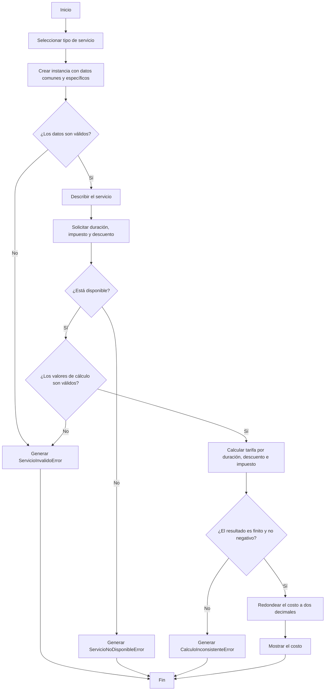

# Software FJ

## Contexto

El objetivo de este proyecto es desarrollar una aplicación orientada a objetos
en Python para Software FJ, enfocada en la gestión de clientes, servicios y
reservas. La solución aplica los pilares de la programación orientada a objetos
(abstracción, encapsulamiento, herencia y polimorfismo) y un manejo robusto de
excepciones para validar las operaciones y registrar los errores del sistema.

Sistema de gestión de clientes, servicios y reservas (trabajo colabortivo) hecho en Python con programación orientada a objetos. Fase 4 del curso Programación (213023) grupo 644, UNAD.

## Cómo ejecutarlo
Requiere Python 3.11 o superior.
python main.py

## Como se usan las excepciones y los logs 

Se importa lo que se necesita en el modulo:

from software_fj.excepciones import ClienteInvalidoError
from software_fj.registro_logs import configurar_logs, registrar_evento, registrar_error

- 'configurar_logs()' se llama solo una vez, al inicio de 'main.py'.
- 'registrar_evento("texto")' guarda gurda los eventos normales en 'logs/eventos.log'.
- 'registrar_error(error)' guarda los errores. Si la excepción fue encadenada con 'raise ... from ...', también se guarda la causa.

todas las excepciones heredan 'softwareFJError' por eso se pueden capturar juntas con un solo 'except SoftwareFJError'

## Servicio y servicios especializados

El módulo `software_fj/servicios.py` define la clase abstracta `Servicio` y
tres implementaciones: `ServicioReservaSala`, `ServicioAlquilerEquipo` y
`ServicioAsesoriaEspecializada`. Cada clase valida sus datos, describe el
servicio y calcula el costo mediante la misma interfaz, permitiendo procesar
distintos tipos de servicio de forma polimórfica.

Las tarifas por hora se configuran al crear cada objeto. El cálculo recibe una
duración positiva en horas y admite impuesto y descuento opcionales como tasas
entre `0` y `1` (por ejemplo, `0.19` equivale al 19 %). El resultado se
calcula como `tarifa_por_hora * duración * (1 - descuento) * (1 + impuesto)` y
se redondea a dos decimales. La propiedad `disponible` permite actualizar el
estado del servicio; los servicios no disponibles no permiten calcular un
costo.

| Clase | Parámetros específicos |
|---|---|
| `ServicioReservaSala` | `capacidad_personas` (entero positivo) |
| `ServicioAlquilerEquipo` | `tipo_equipo` (texto no vacío) |
| `ServicioAsesoriaEspecializada` | `especialidad` (texto no vacío) |

Ejemplo:

```python
from software_fj.servicios import (
    ServicioAlquilerEquipo,
    ServicioAsesoriaEspecializada,
    ServicioReservaSala,
)

servicios = [
    ServicioReservaSala("Sala Norte", 50000, 20),
    ServicioAlquilerEquipo("Proyector", 12000, "audiovisual"),
    ServicioAsesoriaEspecializada("Asesoría Python", 80000, "desarrollo"),
]

for servicio in servicios:
    print(servicio.describir_servicio())
    print(servicio.calcular_costo(2, impuesto=0.19, descuento=0.05))
```

Los parámetros inválidos generan `ServicioInvalidoError`, un servicio fuera
de disponibilidad genera `ServicioNoDisponibleError` y un resultado
inconsistente genera `CalculoInconsistenteError`. Estas excepciones pertenecen
a la jerarquía definida en `software_fj/excepciones.py`.

### Diagrama de flujo de mi actividad: servicios especializados

El siguiente flujo resume la creación de un servicio y el cálculo de su costo:



| Integrante | Parte |
|---|---|
| Yefersonmon | Excepciones y registro de logs |
| pendiente | Entidad base y Cliente |
| DianaCastro-04 | Servicio y servicios especializados |
| pendiente | Reserva y simulaciones (main.py) |
